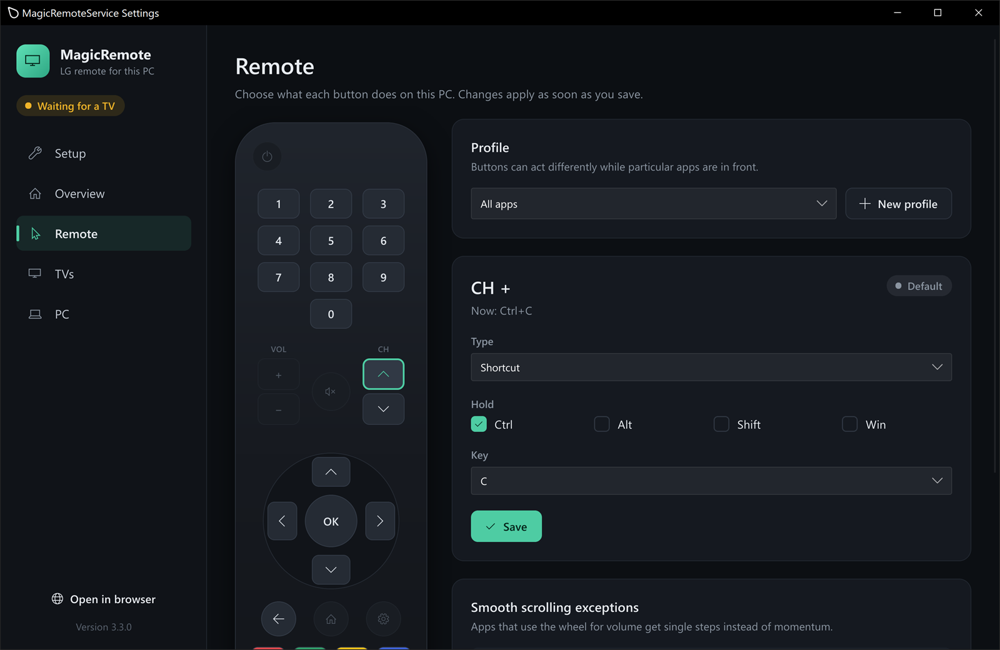
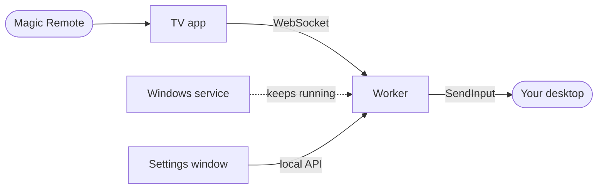

<div align="center">

# MagicRemoteService

**Your LG Magic Remote, now a mouse and keyboard for your Windows PC.**<br>
Point, click, scroll and type from the couch. Written in Rust.

[](https://github.com/roko-tech/MagicRemoteService-Rust/actions/workflows/build.yml)
[](https://github.com/roko-tech/MagicRemoteService-Rust/releases/latest)
[](#building-from-source)
[](LICENSE)


[Quick start](#quick-start) · [Using the remote](#using-the-remote) · [Settings](#settings) · [How it works](#how-it-works) · [Troubleshooting](#troubleshooting)



</div>

## Highlights

- **Feels like a mouse** — wave the remote to move the pointer. OK clicks, a long press right-clicks, the wheel scrolls with momentum, and the TV's keyboard types.
- **Every button is yours** — map any button to a click, a key, a shortcut, a command or a TV action, and give apps such as VLC their own layout.
- **Set up from the PC** — run the exe and Setup installs the service, finds your TV, pairs it and installs its app, in three steps.
- **Tune it live** — cursor speed, scroll speed and long-press time reach the TV the moment you save.
- **Stays out of the way** — one small Windows service. It starts with Windows, wakes the PC from the TV, and can shut it down when you're done.
- **Written in Rust** — one self-contained exe with its own SSH client, so there's nothing else to install: no .NET, Node.js, webOS CLI, OpenSSH or Visual C++ runtime. Its settings window is native too, built with [Slint](https://slint.dev).
- **Private by design** — other devices on your network can't take over the PC, and the settings are only reachable from the PC itself.

## Quick start

| You need | |
|---|---|
| **A PC** | Windows 10 or 11, connected to the TV over HDMI |
| **A TV** | An LG TV with webOS (tested on the C2 and C1) and the free [Developer Mode app](https://webostv.developer.lge.com/develop/getting-started/developer-mode-app), which needs an LG developer account |
| **A network** | The PC and the TV on the same home network, which Windows calls Private (Setup offers to change it) |

1. **Prepare the TV.** Install the Developer Mode app from the LG Content Store, sign in, and turn on **Dev Mode Status** and **Key Server**. The app shows a passphrase: keep it on screen.
2. **Run the app on the PC.** Download `MagicRemoteService.exe` from the [latest release](https://github.com/roko-tech/MagicRemoteService-Rust/releases/latest) and double-click it. The settings open on **Setup**.
3. **Follow the three steps.**
   - **Install** — click it and approve the Windows prompt. It installs a Windows service, so the remote works from the moment Windows starts.
   - **Pair your TV** — your TV is found on the network by itself: pick it and type the passphrase.
   - **Install the TV app** — pick the HDMI input the PC is plugged into, and click **Install on the TV**.

   If Windows calls your network Public, its firewall keeps the TV out: Setup says so and makes it Private in one click.
4. **Turn Key Server off** in the Developer Mode app. It's only needed while pairing.

Then open the app on the TV, or switch the TV to the PC's input, and point.

> [!NOTE]
> The exe isn't code-signed, so Windows may say it protected your PC the first time you run it. Choose **More info**, then **Run anyway**.

> [!TIP]
> Already set up the TV with the webOS CLI (`ares-setup-device`)? The service picks it up by itself, so there's nothing to pair.

<details>
<summary><b>Updating, uninstalling and installer options</b></summary>

- **Update:** run the new release's `MagicRemoteService.exe`. Setup offers **Update**; your bindings, TV settings and registry settings are kept. Then click **Install it again** in step 3 so the TV gets the matching app.
- **Uninstall:** run `"C:\Program Files\MagicRemoteService\MagicRemoteService.exe" uninstall` from an administrator prompt, then remove the app from the TV's app list.
- **Installing from a console:** the release zip has `install.bat`, which does the same steps by asking questions. Choose "PC service only" or "TV app only" in its menu, or pass `-Part Pc|Tv` and `-Hdmi 1-4`, for example `install.bat -Part Tv -Hdmi 4`.
- **From source:** install [Rust](https://rustup.rs) (MSVC toolchain), clone the repository and run `install.bat`; it builds the exe with `cargo` if there isn't one yet.

</details>

## Using the remote

| On the remote | On the PC |
|---|---|
| Point and wave | Move the pointer |
| **OK**, short press | Left click |
| **OK**, long press, or **Yellow** | Right click |
| Wheel | Scroll, with momentum |
| **Arrows** · **OK** · **Back** | Arrow keys · Enter · Escape |
| **CH +** · **CH −** | Copy · Paste |
| **0–9** | Number keys |
| **Red** | Shut down the PC (the TV asks first) |
| **Green** | Start menu |
| **Blue** | Show or hide the TV's keyboard |
| **Play** · **Pause** · **Stop** | Play/pause · Pause · Stop |
| **Fast forward** · **Rewind** | Next track · Previous track |
| Hold **Back** for a second | Leave the TV app |

Every button can be changed in the [settings](#settings).

**Volume** stays with the TV while Windows plays through it (HDMI, DisplayPort or S/PDIF, such as the TV or a soundbar on its eARC). While Windows plays somewhere else, such as headphones, the volume buttons change the PC's volume instead.

**Wake-on-LAN:** with the PC off, opening the TV app or switching to the PC's input wakes it. Shutting the PC down never wakes it again by itself.

## Settings

Run `MagicRemoteService.exe` again, or double-click the tray icon, to open the settings. The window runs as you, never with the service's rights, and works with the keyboard and screen readers. The same settings are at <http://localhost:41231> in a browser on the PC.

| Page | What you can do |
|---|---|
| **Setup** | Install or update the service, find and pair your TV, and install the TV app, in three steps. It also makes a Public network Private, and opens first until everything is done. |
| **Overview** | See whether the service is running, each connected TV (connected for, last input, latency, activity counts, never which keys or text) and recent events. |
| **Remote** | Pick a button on the drawn remote and map it to a mouse click, a key, a shortcut (Ctrl+C, Alt+Tab, Win+D…), a command, or a TV action. Create **profiles** so buttons act differently while particular apps are in front, and list apps that should scroll one step at a time. |
| **TVs** | Pair a TV, choose the default one, or unpair it. Set up the TV app: the HDMI input, the network, the port, and the cursor speed, scroll speed and long-press time, which apply at once. **Reinstall TV App** builds and installs it on the default TV. |
| **PC** | Start with Windows, shut down when the remote is idle or the monitor is off, change the port, and pick the monitor each TV's pointer lands on. |

## How it works



- **One exe, three roles.** The service starts with Windows and keeps the worker running. The worker listens for the TV on TCP 41230, answers its network search on UDP 1900, serves the settings on 127.0.0.1:41231 and moves the pointer with `SendInput`. The settings window is the same exe, started as you.
- **On the TV,** the app (`tv/app`) captures the remote and talks to the PC. A small service (`tv/service`) finds the PC, wakes it, and relaunches the app when you switch to the PC's input.
- **Installing the TV app** needs no developer tools: the service builds the package itself and installs it through the TV's Developer Mode, with an SSH client built into the exe.
- **Settings** are kept in `C:\Program Files\MagicRemoteService` (`bindings.json`, `tv-config.json`, and paired TVs in `tvs.json` with their keys) and in `HKLM\SOFTWARE\WOW6432Node\MagicRemoteService`. **Logs** go to Event Viewer (Application, source MagicRemoteService) and to the Overview page.

## Security

- **Only your TVs.** A TV must present the device token Setup creates; other devices on the network are refused. **New token** on the TVs page replaces it.
- **Only this PC can change settings.** The API listens on loopback, refuses other host names and cross-site requests, and never reveals the token or a TV's passphrase.
- **Least privilege.** The settings window, command bindings and the browser run as you. The service runs from Program Files, where only administrators can change files.
- **Secrets stay with the service.** The token, TV keys and passphrases are readable only by SYSTEM and administrators.
- **Home networks only.** The firewall lets TVs in on Private and Domain networks, never Public ones.

<details>
<summary><b>The details, and the limits</b></summary>

- **Device token.** The TV sends the token in the WebSocket URL and the service compares it in constant time. Every TV must carry the same token, so reinstall the TV app after **New token**. Without a token the service runs in open mode, where anything on the LAN can control the PC, and the settings show "Device token off" in red.
- **What the token doesn't cover.** It travels in cleartext over `ws://`, with no TLS, so a sniffer on your network segment could capture and replay it. It raises the bar on a trusted LAN; it isn't a substitute for one.
- **WebSocket.** Connections from web pages (an `http` or `https` origin) are refused, even in open mode. Frame sizes are capped, the handshake must finish within 10 seconds, at most 16 connections are open at once, and refused connections are logged at most once a minute per address.
- **API.** Changes (POST) need an `X-Requested-With` header, which cross-site pages can't send; send it if you script the API. Any program on the PC can still use the API to change bindings and settings, pair a TV or reinstall the TV app (whose package carries the token), so treat programs on this PC as trusted.
- **TV keys.** A paired TV's SSH key stays encrypted with its passphrase. The service trusts a TV's SSH host key the first time and refuses a different one until the TV is paired again. Turn Key Server off after pairing: the key it serves is protected only by the short passphrase.
- **Command bindings.** `& | ; < >` are refused so a binding can't chain commands, but a binding still runs whatever program it names.
- **Typing.** Don't enter passwords with the remote.

</details>

## Troubleshooting

| Problem | What to do |
|---|---|
| The TV can't reach the PC after its IP changed | On the TVs page, choose the network, **Save** and **Reinstall TV App**. A DHCP reservation in your router stops it changing. |
| The TV keeps retrying; Overview shows "invalid or missing token" | The TV app carries an old token: click **Reinstall TV App**. |
| The settings say the service isn't answering | Start the service, then **Try again**. `MagicRemoteService.exe status` shows its state. |
| Pairing can't reach the key server | Turn on **Key Server** in the TV's Developer Mode app, and check the IP. |
| Reinstall TV App can't reach the TV | Turn the TV on and check **Dev Mode Status** in the Developer Mode app; the session runs out unless you extend it there. |
| The TV refused the key, or isn't the TV that was paired | Developer Mode was reinstalled or the TV was reset: pair it again on the TVs page. |
| Setup says Windows calls your network public | Click **Make … private**: the firewall lets the TV in on private networks only. Do it only on a network you trust, such as your home's. |
| The pointer doesn't move but scrolling works | Wave the remote at the TV to wake the gyroscope; the app retries every 3 seconds. |
| "Service is busy" or "not running" on the TV | Restart the TV, then open the app again. |
| "Failed to get sensor data [1003]" | Normal on webOS 25; the app retries in the background. |
| The TV app takes a minute to appear | Normal after a cold boot: webOS takes about a minute to start developer apps. |
| The TV shows "Disconnected" soon after the PC sleeps | Expected: the TV notices within 15 seconds and reconnects when the PC wakes. |
| The pointer can't reach the TV's home launcher | Expected in overlay mode: use the arrows on the launcher. |
| Worried about burn-in on an OLED | The app keeps the TV's screensaver off while the PC is connected, so videos aren't interrupted. Set Windows to turn the display off after a few minutes (Settings › System › Power): it stays on during video, and an idle desktop goes dark. |

## Command line

| Command | What it does |
|---|---|
| `MagicRemoteService.exe install` | Copy the exe to `C:\Program Files\MagicRemoteService` and install or update the service from there (administrator) |
| `MagicRemoteService.exe uninstall` | Stop and remove the service (administrator) |
| `MagicRemoteService.exe status` | Show the service's state, port and connected TVs |
| `MagicRemoteService.exe private-network <id>` | Make that network Private, so the firewall lets the TV in (administrator; Setup runs it for you) |
| `MagicRemoteService.exe` | Open the settings (which set everything up the first time) |
| `MagicRemoteService.exe --standalone` | Run on its own with a tray icon, without the service |
| `MagicRemoteService.exe --port 41330 --no-ssdp` | Run a second copy beside the service, to try a build |

The exe has no console window: in PowerShell, pipe it (`… status | Out-Host`) to see the output.

## Building from source

You need Rust 1.95 or newer with the MSVC toolchain (`rustup` installs it; the Windows SDK supplies the resource compiler).

```powershell
cargo test
cargo build --release   # target\release\MagicRemoteService.exe
```

`cargo test -- --ignored` also runs the tests that need real hardware. They read this PC's audio device and networks and search the network for TVs. On the TV set up in the webOS CLI, they sign in, pair (with Key Server on), and install, list and remove a throwaway copy of the TV app.

```
src/          the PC service, in Rust
  win/        Windows calls
  ui/         the settings window's logic
ui/           the settings window, in Slint
tv/app/       the webOS app
tv/service/   its webOS service
resources/    the web page, icon, cursor and manifest built into the exe
tests/        integration tests
```

Every push runs formatting, lint and tests in CI. Pushing a `v*` tag publishes a release.

## Release history

- **3.3** — everything in one exe: the SSH client and the C runtime are built in, so a new PC needs nothing else installed. Setup spots a Public network and makes it Private in one click.
- **3.2** — guided setup: run the exe and the settings install the service, find your TV on the network, pair it and install the TV app in three steps, and offer updates; one click is enough everywhere in the settings window.
- **3.1** — a native settings window; the TV app installed without Node.js, with pairing in the settings and the installer; cursor speed, scroll speed and long press applied live; per-app profiles; per-TV diagnostics; a heartbeat so the TV notices a PC that went quiet; the device token kept inside the service.
- **3.0** — the PC side rebuilt in Rust: one exe with no .NET, a supervisor that restarts its worker, and settings that apply without a restart.
- **2.x** — the C# version: discovery, the web settings page, smooth scrolling and device token auth.

See [Releases](https://github.com/roko-tech/MagicRemoteService-Rust/releases) for the full notes.

## Credits and license

Based on [Cathwyler/MagicRemoteService](https://github.com/Cathwyler/MagicRemoteService). Licensed under the [GPL-3.0](LICENSE).

LG, webOS and Magic Remote are trademarks of LG Electronics. This project isn't affiliated with or endorsed by LG.
